# Payphone Network Manager

A desktop program for running a network of **Elcotel Series 5 payphones**: customers, contracts,
sites, phones, routes and technicians; service and alarm handling; work orders; cost accounting
and commissions; poll lists; and calling the payphones themselves to read their counters,
cashbox, alarms and call records and to send them rate files.

It is a modern rebuild of the Windows 3.x program *PNM Plus* (Payphone Network Management
System Plus), written in Rust with [egui](https://github.com/emilk/egui). It keeps the original's
classic grey layout and screen names.

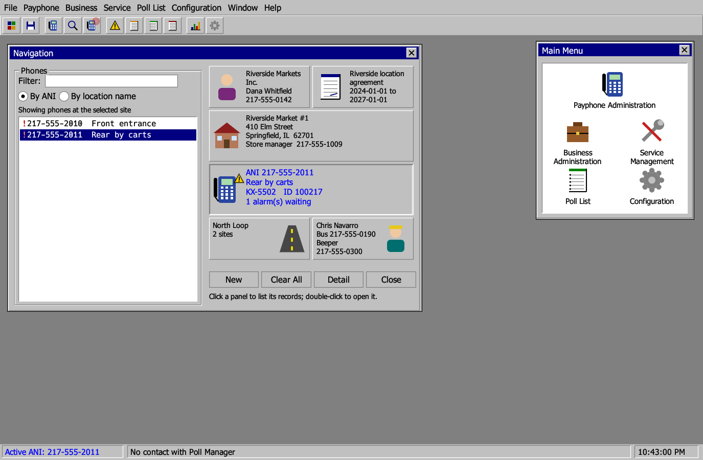

## Disclaimer

This program was **created with AI**, using the **decompiled source code of the original
payphone management software (PNM Plus)** as its reference. Its communication with payphones was
**tested against an emulated Elcotel Series 5 payphone** running the phone's own firmware, not
against every real phone or firmware version. Use it with care on phones in service.

It is not made, endorsed or supported by Elcotel or QuorTech Solutions. "Elcotel", "PNM Plus" and
"QuorTech" are names of their respective owners and are used here only to describe compatibility.

## Contents

- [Features](#features)
- [Screenshots](#screenshots)
- [Building](#building)
- [Connecting to payphones](#connecting-to-payphones)
- [The payphone communication protocol](#the-payphone-communication-protocol)
- [Command line](#command-line)
- [Project layout](#project-layout)
- [Tests](#tests)

## Features

- **Payphone administration**: a Navigation screen that links customers, contracts, sites,
  phones, routes and technicians, with a detail screen for each. Phones keep their model, serial
  numbers, security values (Phone ID, PNM password, owner bypass), cashbox, keys, rate and tax
  templates, operational files and when each was last sent to the phone.
- **Calling payphones** (Dial Payphone): read software versions, status (cashbox, last
  collection, totalizer, alarms, the phone's clock), call counters, call records (SMDR) and the
  phone's data block; send a `.R94` rate file and have the phone store it; send a single raw
  command byte to try things out. Every byte sent and received is shown in the results log.
- **Three ways to reach a phone**: a Hayes modem on a serial port, a modem reached over TCP, or the
  **built-in SIP modem**, which places the call over SIP and plays real modem tones itself
  (Bell 212A at 1200 bit/s or Bell 103 at 300 bit/s).
- **Poll lists**: lists of phones and commands run on a half-hourly schedule or on demand; calls
  are queued and made one at a time.
- **Service management**: phone status and alarm handling (with the site contact and the
  route's technician), work orders, customer service records with a refund letter, diagnostics
  (call records and call counts), contact history and a RAM image / security view.
- **Business administration**: cost accounting journal with totals and a summary by account
  code, commission calculation per contract, charged-rate and tax-rate templates, account codes,
  journal purge.
- **Configuration**: rate files, speed dial, priority parsing, scrolling messages, rep/cards,
  registers & options and voice files; phone macros; global changes to groups of phones; system
  and modem settings with editable PNM command codes.
- Statistics, information messages, database backup.

Everything is kept in one JSON file, `%APPDATA%\PayphoneManager\database.json` (on other systems
`~/PayphoneManager/database.json`). A first start creates a small sample network to explore.

## Screenshots

| | |
|---|---|
| 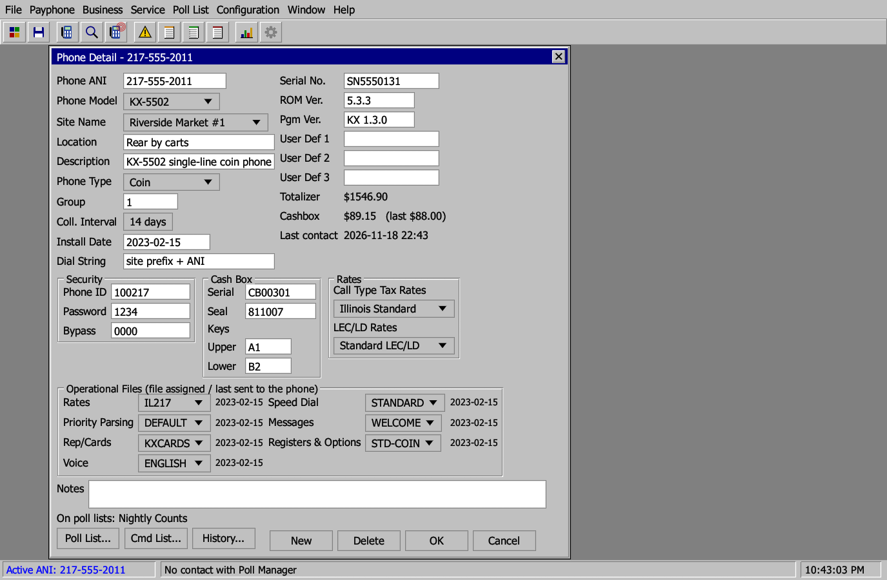 **Phone Detail** | 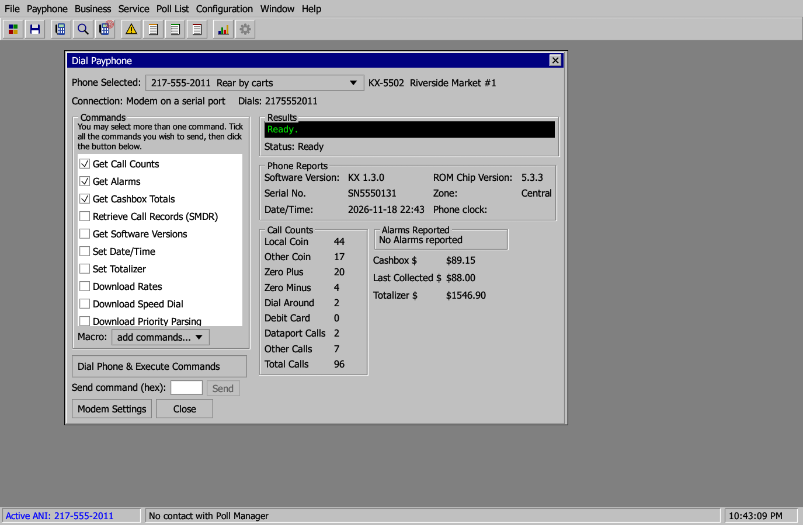 **Dial Payphone** |
| 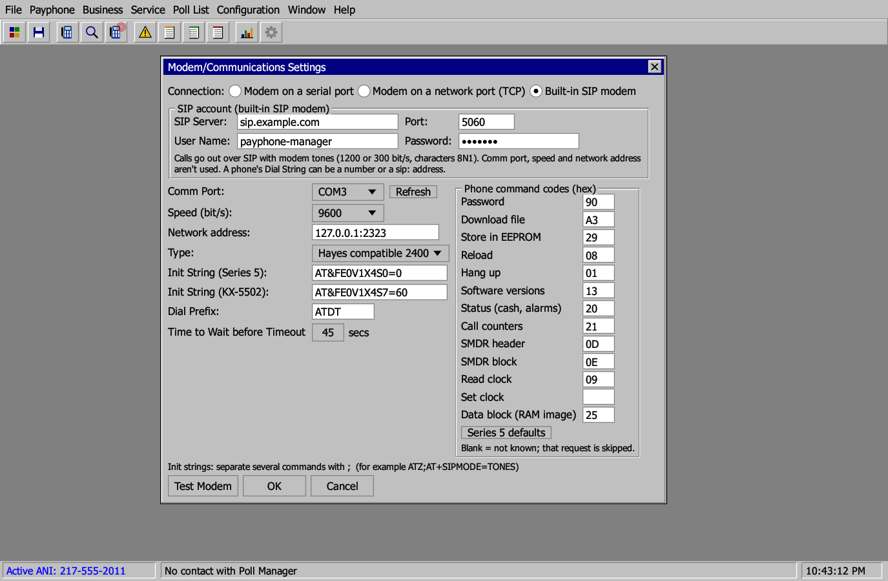 **Modem Settings** (built-in SIP modem) | 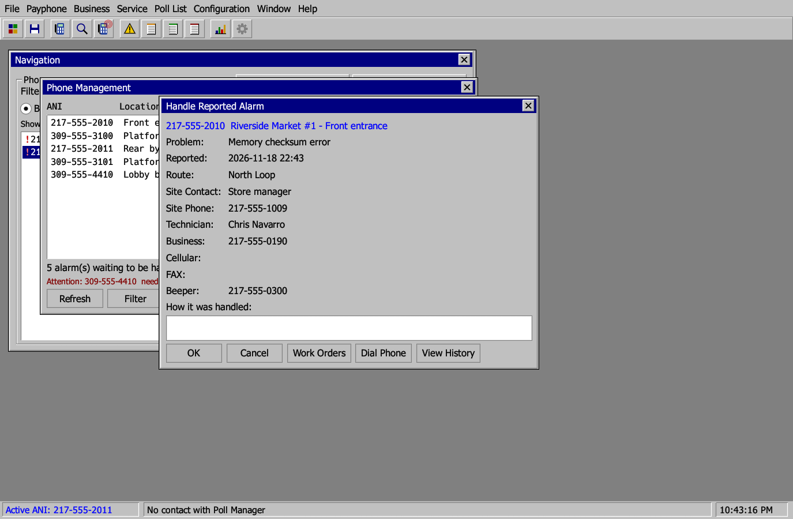 **Phone Status / Handle Alarm** |
| 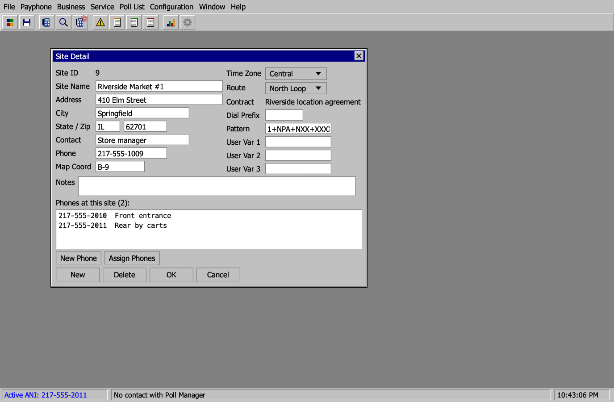 **Site Detail** | 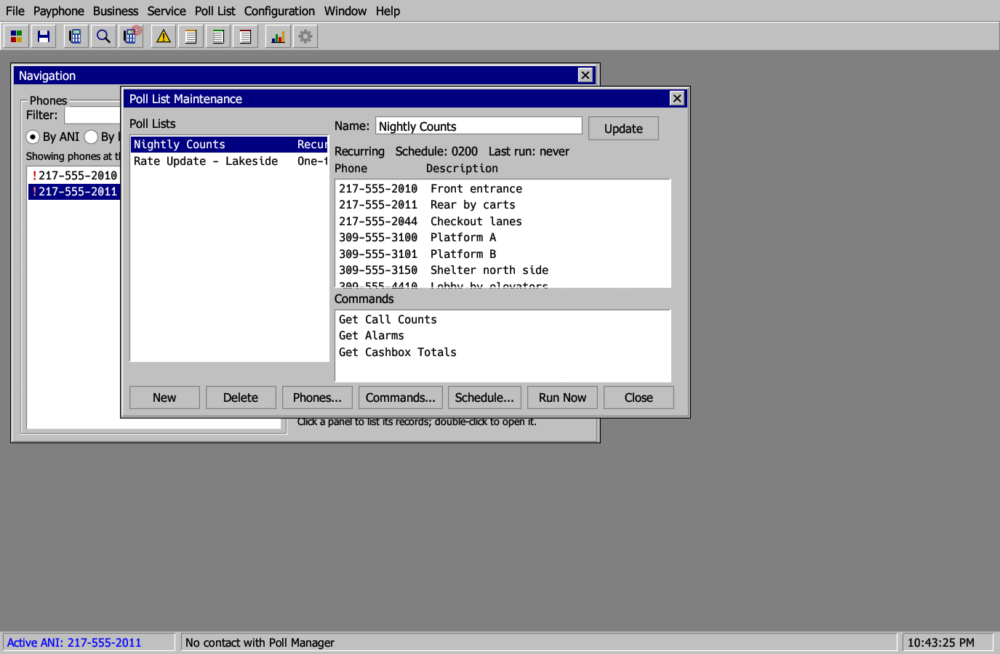 **Poll List Maintenance** |
| 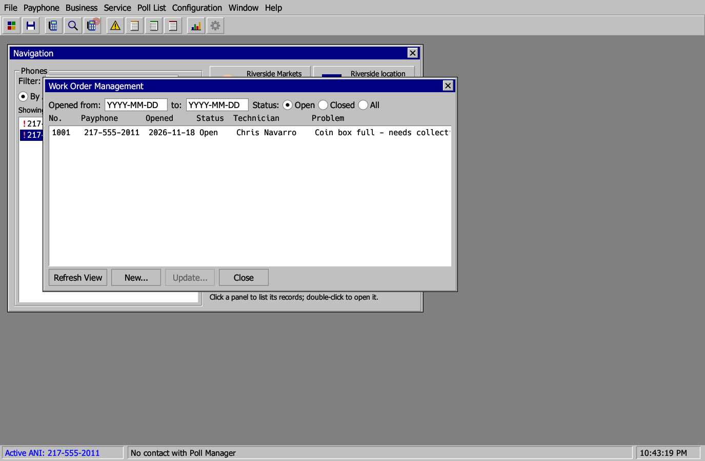 **Work Order Management** | 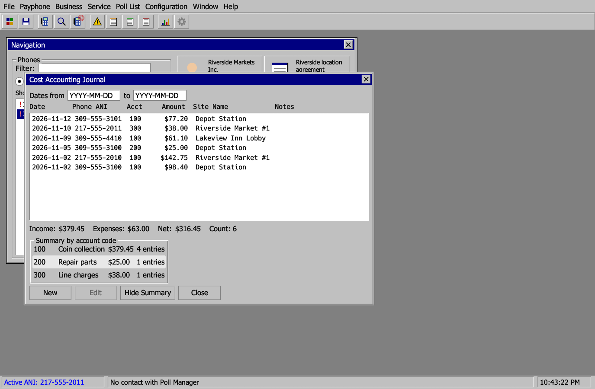 **Cost Accounting Journal** |
| 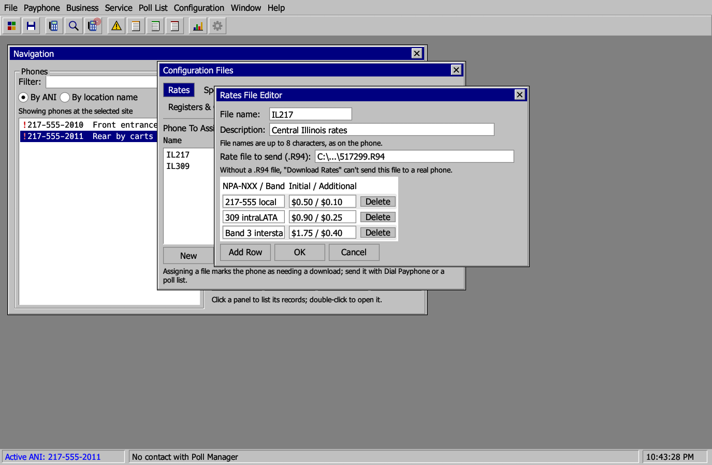 **Configuration Files** | 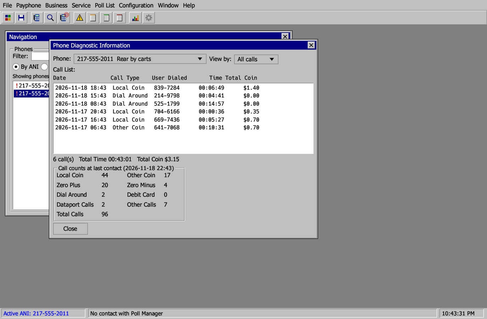 **Phone Diagnostics** |
| 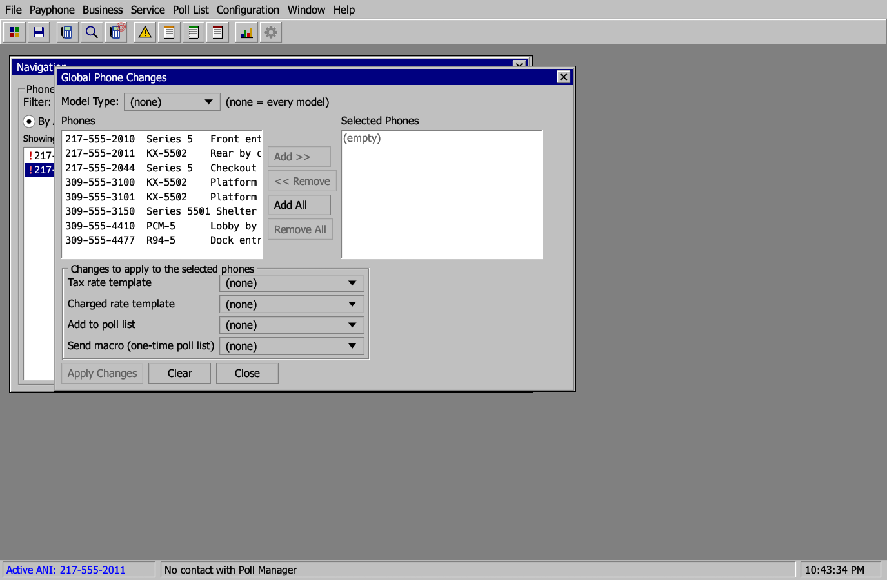 **Global Phone Changes** | 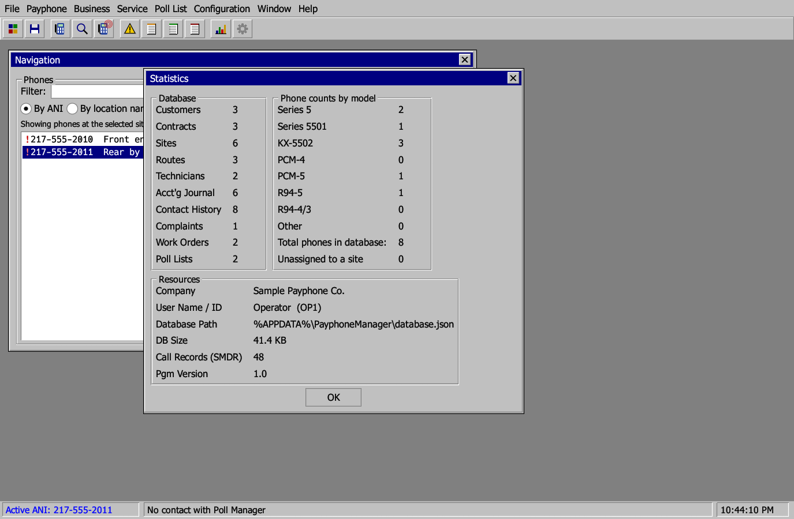 **Statistics** |
| 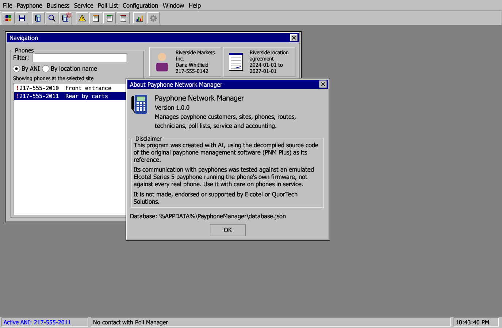 **About** | |

The pictures show the built-in sample data. They are made by the program itself:
`payphone-manager --screenshot <file.png>` draws the window and saves it, and the environment
variable `PAYPHONE_SCENE` opens extra windows first, for example
`PAYPHONE_SCENE=phone` or `PAYPHONE_SCENE=status,handle`. The scene names are in `src/app.rs`.

## Building

You need a stable Rust toolchain ([rustup.rs](https://rustup.rs)).

```sh
cargo build --release
cargo run --release
```

Notes for Windows with the **GNU** toolchain (`x86_64-pc-windows-gnu`):

- `Cargo.lock` pins a few Windows binding crates (`arboard`, `chrono`, `libloading`,
  `parking_lot`, `webbrowser`) to versions that link through import libraries. Newer versions use
  `raw-dylib`, which needs an assembler the toolchain doesn't ship. Avoid a blanket
  `cargo update`.
- `build.rs` lets the linker use Windows' own `shlwapi.dll`, which the bundled MinGW libraries
  lack. Nothing changes on other targets.

The MSVC toolchain, Linux and macOS need neither workaround.

## Connecting to payphones

Open **Configuration > Modem/Communications Settings** and choose a connection:

| Connection | What it is | Settings used |
|---|---|---|
| Modem on a serial port | A Hayes-compatible modem on a COM port (a real modem, or a virtual one through a COM-port pair) | Comm port, speed, init strings, dial prefix |
| Modem on a network port (TCP) | A Hayes-compatible modem that accepts AT commands over TCP | Network address (`host:port`), init strings, dial prefix |
| Built-in SIP modem | A modem inside the program: it places the call over SIP and makes the modem tones itself | SIP server, port, user name, password |

For each phone, **Phone Detail** holds what the phone checks at logon:

- **Phone ID**: the phone's station ID, register 402.
- **Password**: its PNM password, register 403.
- **Dial String**: what to dial, as a number or a `sip:` address. When it's blank, the program
  dials the site's dial prefix followed by the ANI.

The character format must be **8N1**. The phone ignores a logon sent as 7E1, because the top bit of
every byte is turned into parity. The built-in SIP modem always uses 8N1; set an external modem the
same way.

## The payphone communication protocol

This is the protocol PNM Plus uses to manage Elcotel Series 5 payphones. It is reconstructed from
three sources, which agree:

- the decompiled PNM Plus communications module (`CommCtl...` routines);
- the phone firmware's own command handling, run in an emulator;
- a probe of every command byte against the stock firmware (PCM 05.04.04).

### Line and modem

| | |
|---|---|
| Modulation | Bell 212A (1200 bit/s DPSK) or Bell 103 (300 bit/s FSK); the phone's modem answers |
| Characters | 8 data bits, no parity, 1 stop bit (8N1) |
| Modem control | Hayes AT commands: `ATDT<number>` to dial, wait for `CONNECT`; `+++` (with a guard time before and after) then `ATH` to hang up |
| Settle time | After `CONNECT`, wait **3.5 seconds** (PNM: 0.5 s + 3 s) before the logon. A logon sent sooner is ignored, and later tries in the same call are ignored too |

### Framing

All multi-byte numbers are little-endian. Three kinds of message travel on the line:

- **Command** (PC to phone): `02 <cmd> 03`
- **Data frame** (either way): `<len lo> <len hi> <data...> <sum>`, where `sum` is the low byte of the
  sum of the data bytes.
- **Reply to a query** (phone to PC): `06` followed by a data frame, that is
  `06 <len lo> <len hi> <data...> <sum>`.

Single-byte answers:

| Byte | Meaning |
|---|---|
| `06` ACK | accepted / go ahead |
| `07` | station ID accepted (logon) |
| `0B` | settings stored in EEPROM |
| `0C` | refused to store (settings stay in battery RAM) |
| `0F` | nothing to send (for example no call records) |
| `15` NAK | rejected (wrong password, bad block: send again) |
| `18` | unknown command |
| `19` | could not reload |

### Session

1. **Logon**: `02 <station ID digits> 03`. Each digit is sent as its value (0-9), not as ASCII,
   and the ID is left-padded with zeros to at least 4 digits. A 10-digit ID is packed two digits
   per byte, with the first byte as `(d1 - 2) * 16 + 128 + d2`. The phone answers `07`. PNM tries
   three times.
2. **Password**: `02 90 03` (the phone answers `06`), then a 24-byte data frame:

   | Bytes | Content |
   |---|---|
   | 0-6 | the last 7 digits of the phone's ANI, as values 0-9 |
   | 7 | `01` |
   | 8-13 | the PC's clock: minute, hour, weekday (Sunday = 1), day, month, year (two digits). Minute, hour, day, month and year are BCD |
   | 14 | `enc(password length)` |
   | 15-22 | `enc()` of each of the 8 password characters, padded with `00` |
   | 23 | `enc((length + sum of the characters) mod 256)` |

   `enc(x)` inverts the byte and rotates it right by one bit: `v = 255 - x; enc = (v >> 1) | ((v & 1) << 7)`.
   The phone answers `06`, or `15` for a wrong password.
3. **Queries and actions**: see the command table below.
4. **Hang up**: `02 01 03`, then the modem escape and `ATH`.

### Commands (stock Series 5 firmware, PCM 05.04.04)

| Cmd | What it does | Reply |
|---|---|---|
| `01` | end the session | `06` |
| `08` | reload rates and options from EEPROM into RAM | `06` (`19` when there is nothing to reload) |
| `09` | read the phone's clock | 6 bytes: minute, hour, weekday, day, month, year (BCD) |
| `0D` | call-record (SMDR) header *(inferred)* | header, or `0F` when there are no records |
| `0E` | next call-record block *(inferred)* | block of 64-byte records, or `0F` at the end |
| `13` | software versions | 16 bytes, see below |
| `20` | status | 48 bytes, see below |
| `21` | call counters | 16-bit counters by call type (304 bytes on 05.04.04; PNM uses the first 101) |
| `25` | phone data block (RAM image) | 507 bytes; starts with the model and version text (for example `LP050404`); fields not mapped yet |
| `29` | store RAM settings in EEPROM | `06`, then `0B` (stored) or `0C` (refused) |
| `90` | password follows | `06`, then the password frame |
| `A3` | file block follows (rate file download) | `06`, then a data frame |

The firmware also answers `22` (512 bytes), `24` (`0F`), `28` and `A0` (48-byte status-like
blocks), and `00 23 26 27 2A 2B 89 91 A2 AA` (`06`, waiting for data). Their purpose isn't known
yet; the set-clock, set-totalizer and clear-alarms commands are probably among them. Every other
byte answers `18`. Modem Settings lets you change any command code.

### Reply layouts

Offsets are into the data of the reply.

**Versions (`13`)**

| Bytes | Content |
|---|---|
| 0-2 | program version, one number per byte (`05 04 04` = 05.04.04) |
| 3-7 | serial number, 10 BCD digits |
| 8 | program version letter (space when none) |
| 9-11 | ROM chip version |
| 12 | chip version letter |
| 13-14 | model code |

**Status (`20`)**

| Bytes | Content |
|---|---|
| 0-1 | cashbox, in units of 5 cents |
| 2-3 | last collection, in units of 5 cents |
| 4-35 | 32 alarm flags: a non-zero byte *n* means alarm number *n* is reported |
| 36-41 | the phone's clock: minute, hour, weekday, day, month, year (BCD) |
| 42-43 | an amount in units of 5 cents (purpose unknown) |
| 44-47 | totalizer, 32 bits, in units of 5 cents |

**Call counters (`21`)**: 16-bit counters indexed by call type (1-based). PNM sums them into its
categories:

| Category | Counters |
|---|---|
| Local coin | 5, 20 |
| Other coin | 6-9 |
| Zero plus | 41-56, 72-75 |
| Zero minus | 34, 37, 38 |
| Dial around | 10, 11, 14 |
| Debit card | 100 |
| Dataport | 99 |
| Other | everything else |

**Call record (SMDR), 64 bytes each**

| Bytes | Content |
|---|---|
| 12-19 | number dialled, two BCD digits per byte (`B` = `*`, `C` = `#`, `F` = unused) |
| 20, 21, 22, 23 | month, day, hour, minute (BCD) |
| 25-26 | duration in seconds |
| 27-28 | price |
| 29 | call type |
| 30 | macro number |
| 46 | year (BCD, two digits) |
| 47-56 | dial-around number (BCD digits) |

### Downloading a rate file (`.R94`)

1. Send `02 A3 03`; the phone answers `06`. Send a data frame of the file's first 52 bytes (the
   header); `06`.
2. The packed body starts at byte 268 of the file. It goes in blocks of at most 1024 bytes, and a
   block never ends on the first byte of a `00 nn` pair. Add `00 00` to the end of the last block.
   For each block, send `02 A3 03` (`06`), then the block as a data frame (`06`, or `15` to send it
   again).
3. Send `02 29 03` to store it in EEPROM. Wait for `0B`, which can take several seconds; `0C`
   means the phone refused.
4. Send `02 08 03` to have the phone reload its rates and options from EEPROM; `06`.

### Still unknown

- The set-clock, set-totalizer and clear-alarms commands.
- Whether `0D`/`0E` really are the call-record requests. They answered "nothing to send" in
  testing, which is how PNM's call-record request reports none.
- The layout of the 507-byte data block (`25`).
- The file formats for speed dial, priority parsing, messages, rep/cards and registers & options,
  so those files aren't sent yet.
- KX-5502 differences: only Series 5 firmware was tested.

## Command line

```sh
payphone-manager --screenshot shot.png      # draw the window, save it as PNG, exit
payphone-manager --call <COMx | host:port | sip> <dial string> <phone id> <password> [what...]
```

`--call` makes one call without the window and prints every byte, which is useful for checking a
modem and a phone. `what` can be any of:

| Word | Does |
|---|---|
| `versions`, `status`, `counters` | the default set |
| `smdr`, `clock`, `ram`, `store` | the other queries and actions |
| `raw:XX` | send command byte `XX` |
| `rates:FILE.R94` | download a rate file |

With `sip`, the call uses the SIP account saved in Modem Settings. Environment variables
`MODEM_INIT` (init commands separated by `;`), `DIAL_CMD`, `CONNECT_SECS` and `ANI` adjust the call.

## Project layout

| Path | Contents |
|---|---|
| `src/main.rs` | start-up, `--screenshot` and `--call` |
| `src/app.rs` | main window: menus, toolbar, status bar, main/business/service/config menus, statistics, about |
| `src/model.rs` | the database (records, settings, sample data), saving and loading |
| `src/state.rs` | which windows are open and what they edit |
| `src/style.rs` | the classic grey look, child windows, list boxes, drawn icons |
| `src/nav.rs` | Navigation and Find A Phone |
| `src/details.rs` | customer, contract, site, phone, route and technician detail windows |
| `src/service.rs` | phone status and alarms, work orders, customer service, diagnostics, RAM image |
| `src/business.rs` | cost journal, commissions, rate and tax templates, account codes |
| `src/poll.rs` | poll lists, the scheduler, Dial Payphone |
| `src/config.rs` | configuration files, modem settings, macros, global changes, purge |
| `src/calls.rs` | turning commands into phone operations, the call queue, saving results |
| `src/link.rs` | the PNM session: serial/TCP/SIP connections, dialing, framing, decoding |
| `src/sip/` | the built-in SIP modem: AT commands, SIP calls (digest login, RTP G.711 u-law), Bell 212A/103 software modem |

## Tests

```sh
cargo test
```

The tests cover:

- the logon and password encoding;
- a full session against a pretend phone: versions, status, counters, call records, rate file
  download, store, wrong password and unknown commands;
- two software modems passing the logon bytes to each other in 8N1 at 1200 and 300 bit/s.

## License

No license has been chosen yet. Until one is added, all rights are reserved by the author.
